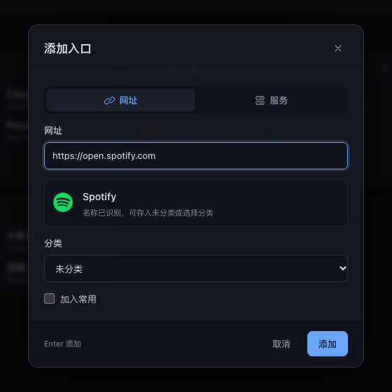
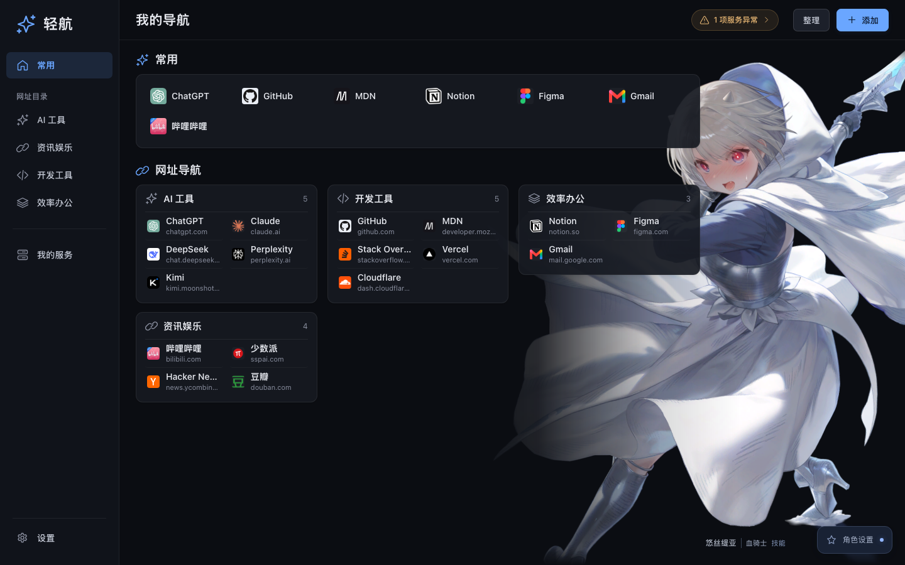

<div align="center">


# 轻航 LiteNav

**轻量、清爽的个人网址与服务导航页**

常用网站一目了然，自建服务掉线即知，还有一位会动的角色陪你上班。


</div>


## 为什么是轻航

- **开箱即用**：一个 Python 文件加一个静态前端，无需安装依赖、无需数据库服务，`python3 server.py` 就能跑。
- **为 PC 日常设计**：深色界面、分栏目录、常用置顶，打开浏览器新标签页就是你的工作台。
- **网站和服务分开管**：公共网站放目录，NAS、软路由上的自建服务放进服务专区并自动巡检。
- **数据在你手里**：配置保存在本地 SQLite，支持一键导出、导入备份。

## 功能一览

### 🧭 网址导航

常用入口置顶，其余网站按分类分栏排列。点“整理”即可编辑、删除，或拖动调整顺序，分类和分栏也能在设置里自由调整。

### ✨ 粘贴即添加

粘贴一个网址，自动识别常见网站的名称、图标和推荐分类，按 Enter 就能保存。局域网地址会自动识别为服务。

<p align="center">
  
</p>

### 🩺 服务专区与掉线提醒

为自建服务填写所在设备与容器，后台定时检测可达性与响应时间。连续失败达到阈值后，页面顶部会出现醒目的异常提醒，点一下就能进入服务专区查看。检测间隔、失败次数和超时都可以在设置里调整。


### 🌸 角色陪伴

可选开启《棕色尘埃 2》角色的 Spine 动画：待机立绘会定时做小动作，也能轮流播放技能演出。支持随机换人、指定人物与服装、选择技能动作，画面会自动适配各种屏幕比例并贴住页面底边。

<table>
  <tr>
    <td width="72%"></td>
    <td width="28%"></td>
  </tr>
</table>

角色设置只保存在当前浏览器，不会写入服务端配置。名单中的男性角色会被自动过滤。看过的角色素材会缓存在浏览器中，再次出现时无需重新下载；离线时可使用内置的本地立绘。

## 快速开始

### 直接运行

需要 Python 3.11 或更新版本，无需安装任何依赖：

```sh
python3 server.py
```

### Docker Compose

```sh
docker compose up -d --build
```

### 使用预构建镜像

GitHub Actions 会为 `main` 分支构建 amd64 / arm64 镜像：

```sh
docker run -d --name litenav -p 8765:8765 -v litenav-data:/app/data ghcr.io/clam314/litenav:latest
```

启动后打开 <http://localhost:8765> 即可使用。

## 数据与备份

- 仓库只包含通用的默认导航（[`seed.json`](seed.json)），首次启动时用它初始化。
- 个人数据保存在 `data/` 目录或 Docker 数据卷中，不会提交到仓库；升级时保留该目录或数据卷即可。
- 在“设置 → 数据备份”中可以导出、导入完整配置，方便迁移到新机器。

## 开发

```sh
npm test
```

会依次运行前端单元测试（`node --test`）和服务端测试（`unittest`）。浏览器回归测试需要额外安装 Playwright：

```sh
pip install -r tests/requirements-browser.txt
```

```sh
python3 -m playwright install chromium
```

```sh
python3 tests/companion_ui_browser.py
```

更多验证细节见 [验证记录](docs/VERIFICATION.md)。

## 声明

角色动画素材来自《棕色尘埃 2》，相关权利归原权利人所有。本项目仅作个人学习与展示，不用于商业用途。素材来源、取景预设和 Spine 运行时许可见 [资源声明](public/companion/NOTICE.md)。
