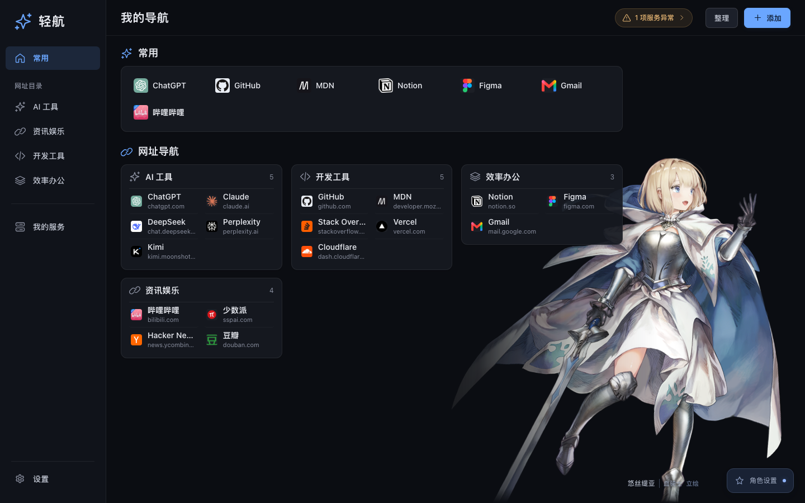
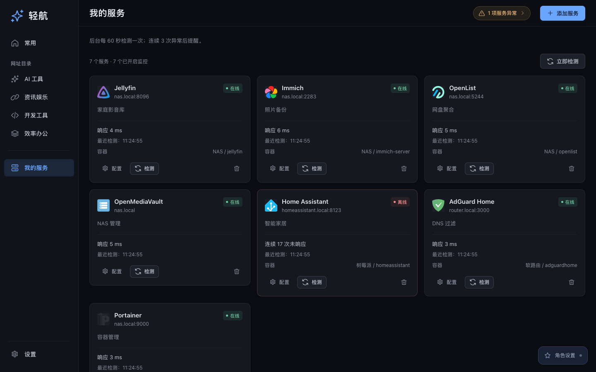
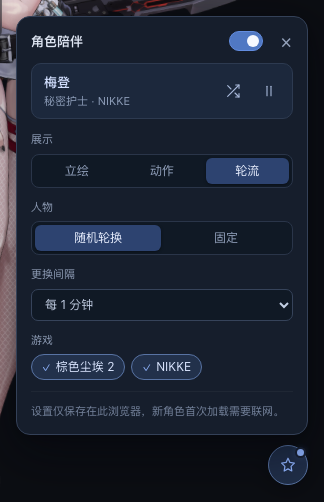

<div align="center">


# 轻航 LiteNav

**轻量、清爽的个人网址与服务导航页**

常用网站一目了然，自建服务掉线即知，还有一位会动的角色陪你上班。


</div>



## 为什么是轻航

- **开箱即用**：一个 Python 文件加一个静态前端，无需安装依赖、无需数据库服务，`python3 server.py` 就能跑。
- **为 PC 日常设计**：深色界面、分栏目录、常用置顶，打开浏览器新标签页就是你的工作台。
- **网站和服务分开管**：公共网站放目录，NAS、软路由上的自建服务放进服务专区并自动巡检。
- **数据在你手里**：配置保存在本地 SQLite，支持一键导出、导入备份。

## 功能一览

### 🧭 网址导航

常用入口置顶，其余网站按分类分栏排列。点“整理”即可编辑、删除，或拖动调整顺序：网址可以直接拖到其他分类，分类拖动标题栏即可换位置或换列；侧边栏和设置里的分类列表同样支持拖动排序。“我的服务”页点“整理”后也能拖动服务卡片排序。

### 🔍 搜索与快速打开

顶栏的搜索框随时可用：按 `/` 或 `Ctrl / ⌘ + K` 开始输入，按名称、域名或拼音首字母（如 `bd` 找到“百度”、`gh` 找到 GitHub）筛选网址和服务，方向键选择，Enter 在新标签页打开。没有找到想要的，最后一项会直接用 Google 搜索。

### ✨ 粘贴即添加

粘贴一个网址，自动识别常见网站的名称、图标和推荐分类，按 Enter 就能保存。局域网地址会自动识别为服务。

已有很多书签？在 Chrome、Edge、Firefox 或 Safari 中把书签导出为 HTML 文件，到“设置 → 导入浏览器书签”选择文件即可。每个顶层文件夹会成为一个分类（子文件夹并入其中），已添加过的网址自动跳过，导入前可预览并勾选文件夹，导入后也能一键撤销。

<p align="center">
  
</p>

### 🩺 服务专区与掉线提醒

为自建服务填写所在设备与容器，后台定时检测可达性与响应时间。连续失败达到阈值后，页面顶部会出现醒目的异常提醒，点一下就能进入服务专区查看。检测间隔、失败次数和超时都可以在设置里调整。



### 🔗 网址体检

在“设置 → 网址体检”点一下“检测全部网址”，后台会逐个检查目录里的网址，并把结果分为几类：

- **疑似失效**：域名已无法解析，或页面返回 404 / 410。首页对应的网址会标出小红点，可逐个编辑、删除，也可一键全部删除（可撤销）。
- **已跳转到其他网站**：网站换了地址（如 `notion.so` → `notion.com`），可一键把入口更新为新地址。同一网站内的跳转、跳到登录页都不算。
- **暂时无法访问**：超时、连接失败、证书错误或 5xx，只做提示，建议先在浏览器中打开确认。
- 返回 401 / 403 / 429 或 Cloudflare 验证页的网站视为可以访问，不会提醒。

检测从运行轻航的服务器发出，失败的网址会再试一次。如果服务器访问部分网站需要代理，可以为容器设置 `HTTPS_PROXY` / `HTTP_PROXY` 环境变量，检测和网址识别都会经过代理；服务检测也会使用这些变量，记得用 `NO_PROXY` 排除局域网地址（如 `NO_PROXY=localhost,127.0.0.1,.lan,.local,.home,192.168.1.10`；这里不支持 `192.168.0.0/16` 这种网段写法，IP 需要逐个列出）。

### 🧰 工具箱

侧边栏的“工具箱”收纳了日常开发与运维中的小工具，全部在浏览器本地运行，内容不会上传到服务器，上次使用的工具和输入会保留在当前浏览器。

| 分区 | 工具 | 能做什么 |
| --- | --- | --- |
| 数据处理 | JSON 格式化与校验 | 美化 / 压缩，标出错误所在行列并一键定位，树形视图可折叠；超长整数和 `1.50` 这类写法原样保留，重复键会提示 |
| | YAML 格式化与校验 | 统一 2 / 4 空格缩进与列表对齐，注释、引号和值的写法保持不变，支持 `---` 多文档 |
| | SQL 格式化与美化 | 关键字大写、子查询与 `CASE` 分层缩进，也可以压缩回一行 |
| | JSON ⇄ YAML 互转 | 双向转换，结果可一键作为输入反向转换；多文档 YAML 转为 JSON 数组 |
| 实用工具 | 时间戳与日期转换 | 自动识别秒 / 毫秒 / 微秒时间戳，或把 `2026-03-09 12:00:00` 换算为时间戳，可选时区 |
| | URL 编解码 | 编码参数或完整链接，解码支持 UTF-8 / GBK，并列出查询参数 |
| | 文本去重与空行清理 | 去首尾空格、删空行、去重（可忽略大小写），按行或按空格 / 逗号拆分，支持自然排序 |

YAML 工具覆盖日常配置的常用写法；锚点与别名（`&` / `*`）、自定义标签和复杂键暂不支持，遇到时会给出明确提示。

### 🌸 角色陪伴

可选开启《棕色尘埃 2》与《NIKKE：胜利女神》角色的 Spine 动画：立绘待机之外，棕色尘埃 2 可以轮流播放技能演出，NIKKE 播放瞄准开火循环。在菜单里勾选游戏来源，默认随机轮换，页面打开期间每隔几分钟换一位角色（间隔可调，先随机游戏再随机人物），刷新页面也会重新随机；也可以固定人物、服装和技能动作。画面会自动适配各种屏幕比例并贴住页面底边，设置入口收在右下角的小圆按钮里。

<table>
  <tr>
    <td width="72%"></td>
    <td width="28%"></td>
  </tr>
</table>

角色设置只保存在当前浏览器，不会写入服务端配置。名单中的男性角色和 NPC 会被自动过滤。角色目录每周由 GitHub Actions 从上游资源自动刷新，新角色和新时装会随之加入。看过的角色素材会缓存在浏览器中，再次出现时无需重新下载；离线时可使用内置的本地立绘。

## 快速开始

### 直接运行

需要 Python 3.11 或更新版本，无需安装任何依赖：

```sh
python3 server.py
```

### Docker Compose

```sh
docker compose up -d --build
```

### 使用预构建镜像

GitHub Actions 会为 `main` 分支构建 amd64 / arm64 镜像：

```sh
docker run -d --name litenav -p 8765:8765 -v litenav-data:/app/data ghcr.io/clam314/litenav:latest
```

启动后打开 <http://localhost:8765> 即可使用。

## 数据与备份

- 仓库只包含通用的默认导航（[`seed.json`](seed.json)），首次启动时用它初始化。
- 个人数据保存在 `data/` 目录或 Docker 数据卷中，不会提交到仓库；升级时保留该目录或数据卷即可。
- 在“设置 → 数据备份”中可以导出、导入完整配置，方便迁移到新机器。

## 开发

```sh
npm test
```

会依次运行前端单元测试（`node --test`）和服务端测试（`unittest`）。浏览器回归测试需要额外安装 Playwright：

```sh
pip install -r tests/requirements-browser.txt
```

```sh
python3 -m playwright install chromium
```

```sh
python3 tests/companion_ui_browser.py
```

手动刷新角色目录（只需 Python 标准库；设置 `GITHUB_TOKEN` 可避免 GitHub API 限流）：

```sh
python3 scripts/update_companion.py
```

NIKKE 新角色若暂无中文名，脚本会列出其编号，在 `scripts/nikke-names.json` 中补充后重新运行即可。

更多验证细节见 [验证记录](docs/VERIFICATION.md)。

## 声明

角色动画素材来自《棕色尘埃 2》与《NIKKE：胜利女神》，相关权利归原权利人所有。本项目仅作个人学习与展示，不用于商业用途。素材来源、取景预设和 Spine 运行时许可见 [资源声明](public/companion/NOTICE.md)。
